# Story

How a Facebook page of design reels became a small, editable skills library.

## 1. Seventy reels, one skill
*Nov 4, 2026*

Itamar shared the A.Song Studio Facebook page and asked me to listen to her explanations and turn them into a design skill. I first found 6 reels. He asked “only 6?”, and I found 70.

- All 70 downloaded with yt-dlp and transcribed locally with faster-whisper
- 9 had no speech, many were reposts
- About 30 distinct lessons remained

They became the skill **Design critique and brand color**.

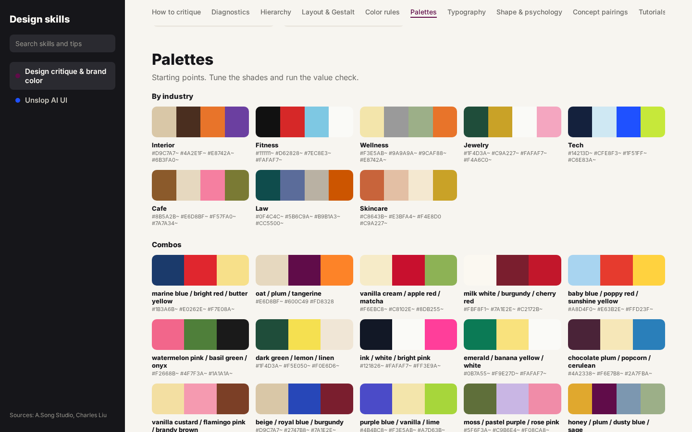

## 2. One creator skipped
Instagram creator createwithalena sat behind a login wall, so she was skipped for now.

## 3. Seeing the skill
Itamar asked how to see the skill visually, so I made a visual Canvas page.

## 4. Unslop
*Nov 5, 2026*

Charles Liu’s reel “How to unslop your designs” became the **Unslop AI UI** skill.

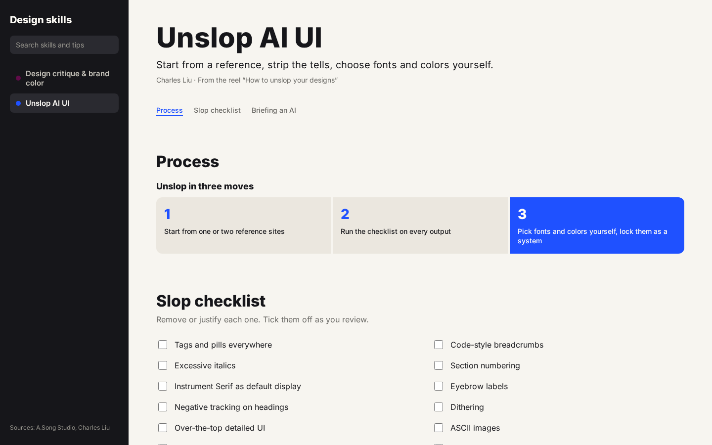

## 5. A skills page in Figma
He asked for a skills list in Figma: page “Design skills” (node 618:2) in file FkbjVFc7kOTvJkZ5ApMNeO.

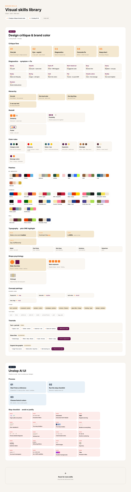

## 6. A local website
He asked for a local site that is easy to edit, with good navigation and not one long row. I built a Vite + vanilla JS site where each skill is one JSON file.

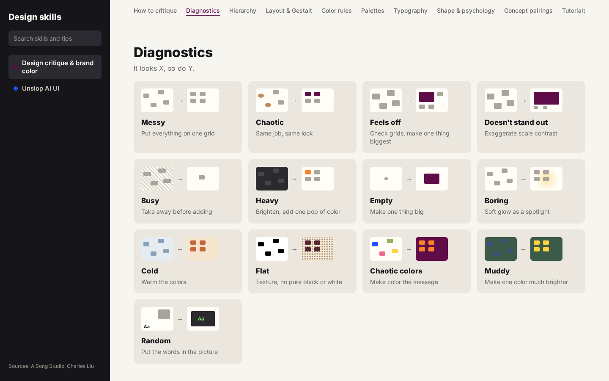

## 7. Impeccable, then eating our own cooking
He asked to add the Impeccable skills (impeccable.style) and to apply the skills to the site itself. A critique pass replaced 23 identical command tiles with grouped lists, among other fixes.

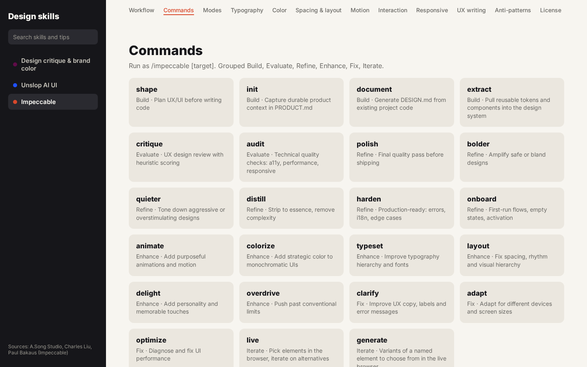
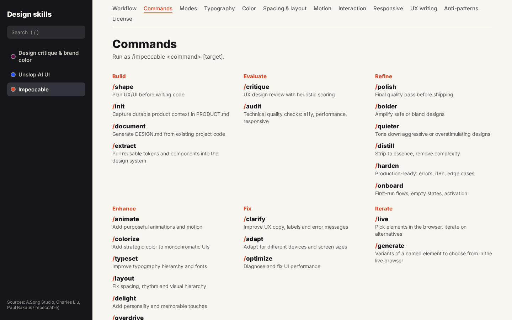

## 8. Restyled in Titan’s visual language
He asked to restyle the site after titan.com. I pulled Titan’s real tokens (warm off-white and near-black, weight-400 type, 10 px radius, pill controls) and applied them, with Hanken Grotesk standing in for the commercial Neue Montreal. Details in docs/TITAN-STYLE.md.

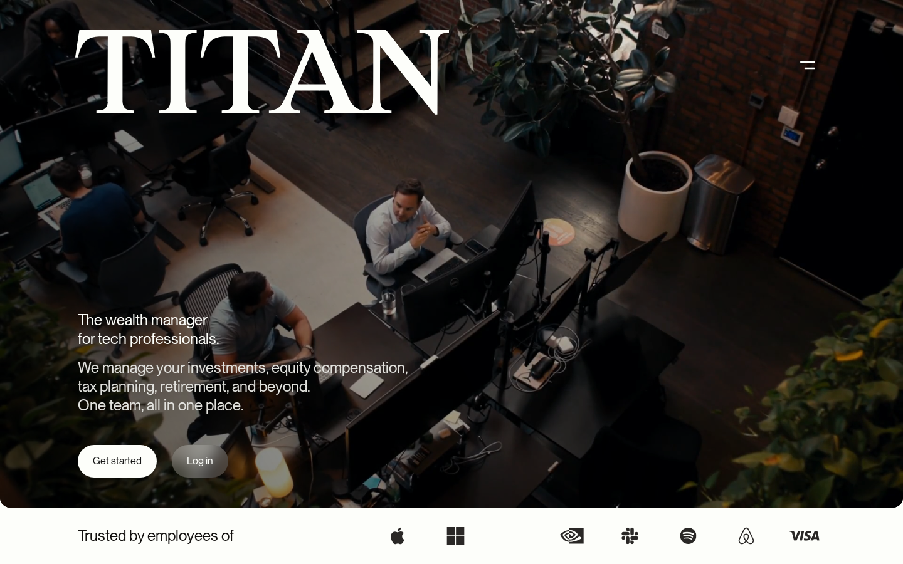
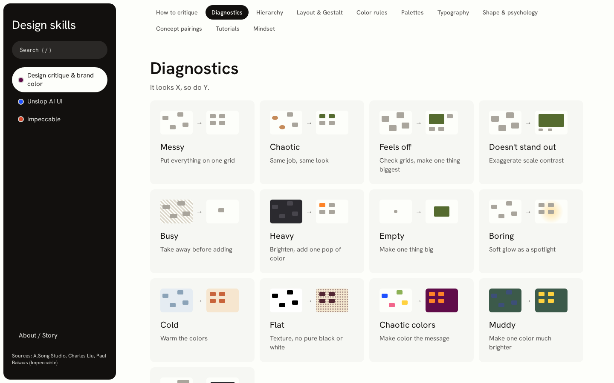

## 9. Reworked information hierarchy after feedback
Itamar found the site hard to find his way around: too much information, no pace, not enough hierarchy. The sidebar became the only navigation, each skill got an overview, every section its own page, and long lists now open on demand.

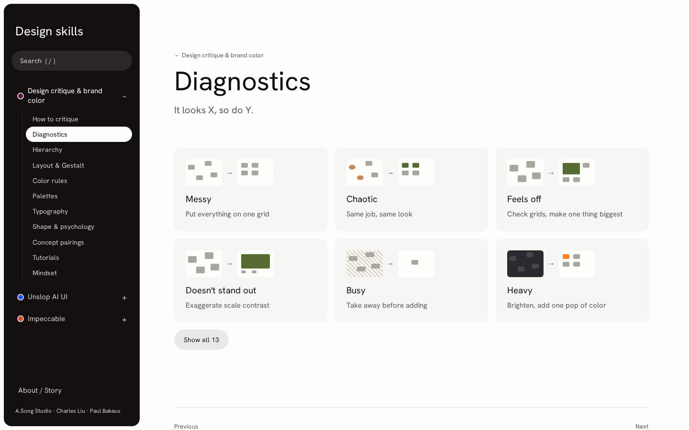

## 10. Cascading interest
Itamar said the hex codes under every palette were noise: a user does not read them. But once a palette catches your eye you want the codes, a way to export it and a look at it in use. That became a rule for the whole site. Layer 1 shows only what you need to scan (name, visual, one line). Click and layer 2 opens in one shared overlay with the codes, full explanation, examples and copy/export. Palettes, diagnostics, fonts and commands work this way now.

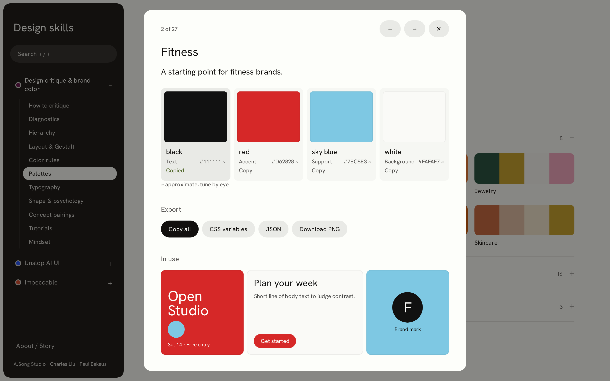
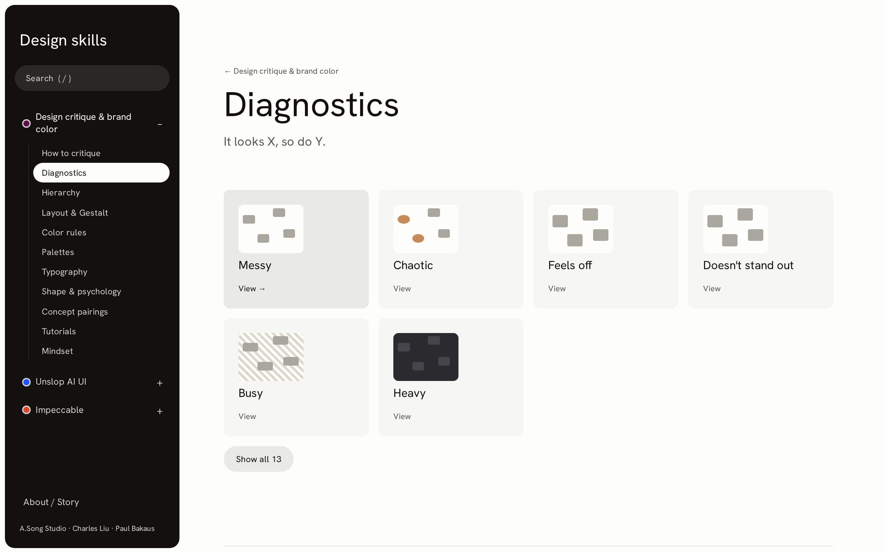

## 11. Unslop pass on the site itself
He asked to run the Unslop AI UI checklist against the whole site. The new overlay was built to pass it: no eyebrow labels, no all-caps, no gradients, solid tokens, hex codes only where you asked for them. The few remaining hits (pills, one caps sample, a dither texture) are deliberate: pills are Titan’s control style, and the others are the examples the skills themselves describe.

## 12. A bigger overlay, related items, more interactivity
Itamar wanted the overlay bigger, with less filler and with related items and actions. It now fills most of the screen. Counters, guessed labels and filler lines are gone, actions sit in one short bar, and a Related strip lets you jump to similar palettes, diagnostics or commands without closing it. He also asked for more interactivity, so cards preview on hover and on keyboard focus: palette swatch names, the diagnostic’s “after” and its fix, fonts in their own face. Tutorials open and close like the other groups.

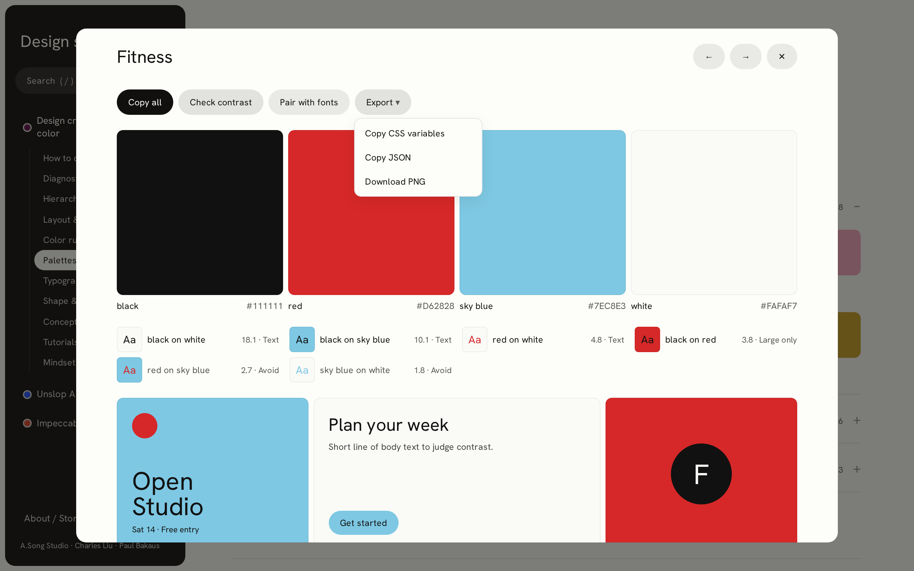

## 13. Better typography
Itamar added Jakub Krehel’s better-typography skill. It became its own skill on the site, with the same pattern: short rules to scan and the CSS in the overlay to copy. Then I applied it to the site: sizes in rem, unitless line-heights per role, balanced headings and pretty paragraphs, tabular numbers on counts, curly quotes and a 16px search field on mobile. The one rule I skipped is negative tracking on headings, because the Unslop checklist and Titan both say no.

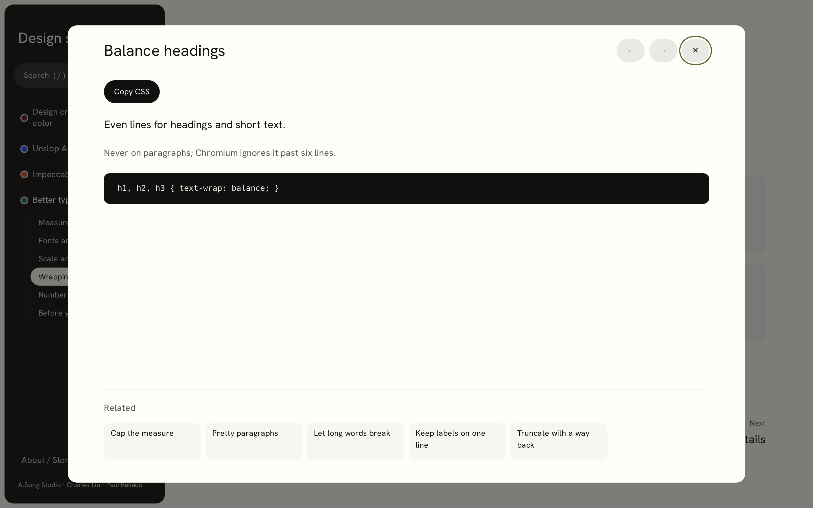

## 14. Motion
Itamar asked for four motion skills, grouped under Motion, and for the site itself to move the Apple way. The sidebar now has three groups: Design, Typography and Motion. Each motion skill has live demos in the overlay: the curve, a Play button and a second lane to compare against, so you can see why ease-in feels slow. The site uses a critically damped spring with no bounce: the overlay grows from the card you clicked, sheets slide up on mobile, accordions open smoothly and pages crossfade. With reduced motion turned on, it fades instead of moving.

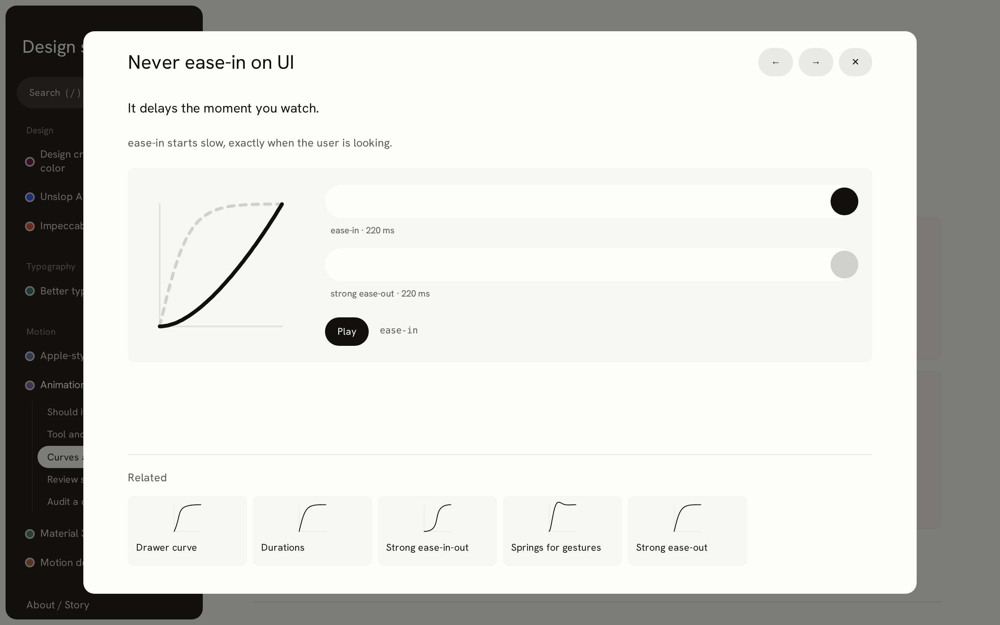

## 15. Easy to press, obvious to click
Itamar said it was hard to see what was clickable and everything was tiny. Group rows became big buttons with a round chevron and a peek at what is inside. The sidebar text and toggles grew, prev/next became large blocks, cards say “Open →”, copying shows a toast, and every control has the same hover, press and focus states. I measured every target: none is under 32 px on desktop or 44 px on touch.

## 16. Restyled after Abduzeedo
He pointed at abduzeedo.com: a white page, bold black type, a plain text category list and big square tiles that are obviously clickable. The dark sidebar is gone. The tree is plain bold text with the current page underlined, titles are big and bold, and palettes, diagnostics, demos and the Home skills are large tiles with the preview centred on warm grey.

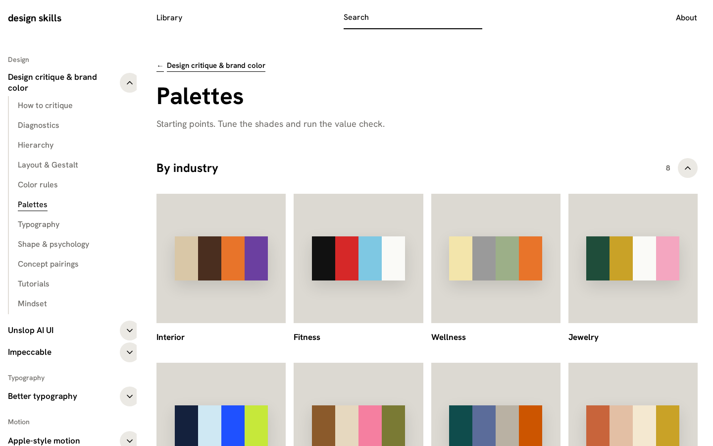

## 17. Quieter
Itamar felt the buttons were too much and didn’t fit. Some corners were also rounded and some weren’t. Following Abduzeedo, the affordance now comes from big tiles, bold text and underlines. The circles, pills and boxes are gone, but the hit areas stay just as large. Corners are 0 everywhere except circles that are part of the content. Black became a graphite ink, ready to be swapped for the Graphite design system.

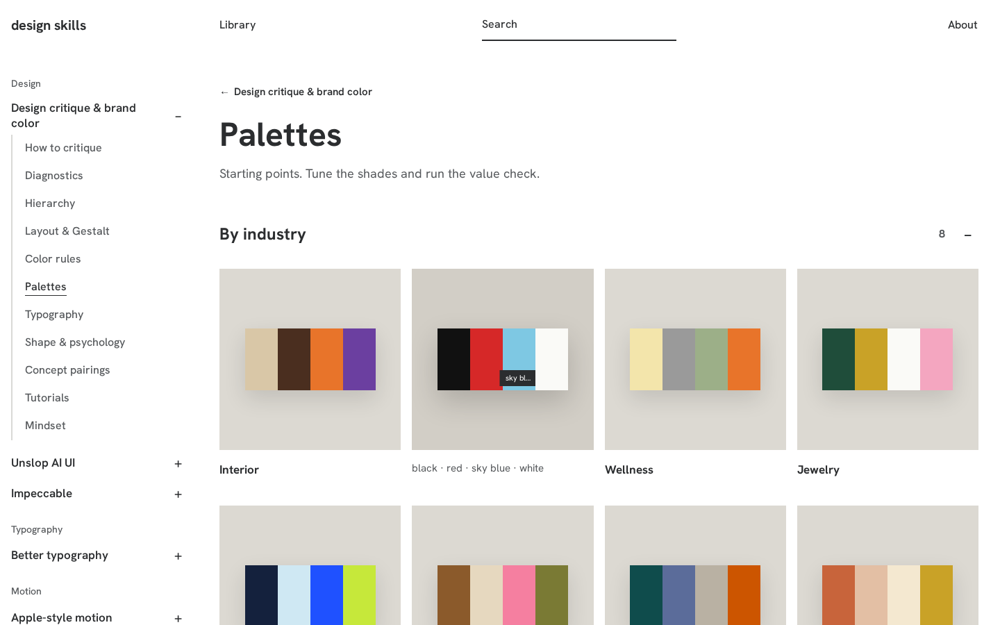

## 18. Graphite
Applied my own design system, Graphite, using the real tokens from the repo, read-only. Inter replaces Hanken Grotesk. The design uses fills, not borders, and a single black action per surface. Radius depends on the role: pill, 12, 18 or 32. The top bar gained a search well with a `/` hint and an Auto/Light/Dark switch. Toasts are now floating pills worded in the past tense. The checks still pass: 0 small targets and no layout shift.

## 19. Spacing, React and QA
I researched spacing rules from Apple HIG, Material 3, Refactoring UI, Every Layout, NN/g and WCAG 2.2, then put every gap and padding on Graphite's tokens (docs/SPACING.md). Inside ≤ between, and headings sit closer to their content than to the section above. Next came a bug: the search field drew a square black ring inside its rounded well. To stop that class of bug, the chrome moved to React using Graphite's own components, with a single focus-ring system. The top bar now shares one 36 px height. A Playwright QA suite checks every component's states on desktop and mobile, in light and dark, along with axe, console, focus-ring, target-size and layout-shift checks. Everything passes.

## 20. One radius system
Corners still looked inconsistent, so radius now comes from a single map of seven `--r-*` variables, all from Graphite tokens. Nested shapes are concentric (inner = outer − inset). Pills are reserved for things you press. The mobile sheet rounds only its top corners. A lint check fails on any raw radius, and a Playwright audit groups computed radii by component and checks nesting. The sidebar selection also got quieter: no pill, just weight and a 2 px marker on the tree line.

## 21. Visual first
"Users like visuals, AI likes text." Home tiles now show a picture and a short title. Every rule card on a section page has a sketch chosen from its words, and the explanation moved into the overlay. Intros are one line and sidebar labels are short. Nothing is lost: each skill and section has a quiet "Copy for AI" button that copies the full markdown. Library and About in the top bar now behave the same.

## 22. One menu
The top bar is now just three things: the logo on the left, search in the true centre and a 36 px "More options" button on the right. That button opens a Radix popover styled with Graphite, holding Library, About, Skills (mobile only) and the Mode switch. It supports keyboard and Esc, returns focus to the button on close, and uses the same focus ring as everything else. Phones get the same pattern.

## 23. Brand
I applied the brand config generated by Graphite, `data-brand="custom"` built from #000000: `src/graphite/brand.css` is loaded after Graphite's CSS. The primary action is pure black with white text in light mode, and #a1a1a1 with black text in dark mode (8.1:1). Titles use Hedvig Letters Sans through `--font-display`, at weight 400 only (the one it ships) with leading 1.1. Body and UI text stay Inter. The site's own old `--brand-*` aliases were renamed `--site-*` so they no longer collide with the brand ramp. Chrome colours that were hard-coded now use tokens. Graphite v1.2.0 has no `data-size` tokens, so `data-size="large"` is set but has no effect yet.

## 24. Calmer swatches, no lines
Palette circles became one joined strip of tall tiles (18 outer corners, flush seams), with name and hex in quiet text below; hover darkens in place, click copies. Accordion rows lost their bottom line: sections are separated by space only.

## 25. Motion you can see
Springs without bounce on Graphite's 140/180/300 ms: pages fade and rise 8 px with tiles staggered 30 ms, accordions open by height and fade, tiles lift 2 px and press to .97, buttons and chips press, the menu scales from its trigger, the sidebar marker slides between pages, copy actions pop. The overlay's grow-from-card had silently stopped after the React move (Radix mounts the dialog one commit late); it runs again. Reduced motion keeps fades and drops movement.

## 26. Less bar
The top bar kept only the logo, search and the menu icon, and got quieter: 56 px tall, no border or shadow, same colour as the page. Search is a transparent 32 px field until hover or focus, placeholder "Search"; the "/" badge is gone but the shortcut still works. The menu is a plain icon with a fill on hover only. Hit areas stay 32 px on desktop and 44 px on mobile through invisible slop, and the scroll padding follows the bar so titles never sit under it.
